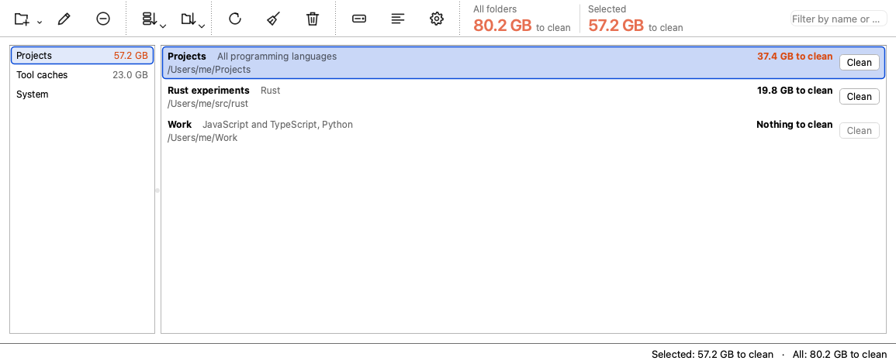
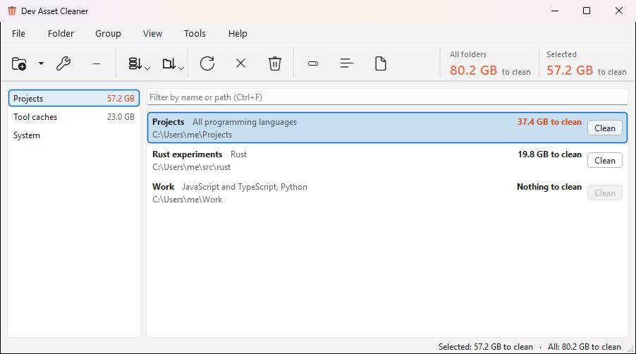

# Dev Asset Cleaner

Programming tools leave large folders behind: Rust's `target`, `node_modules`, CMake build
folders, package caches. Dev Asset Cleaner keeps track of how much space they take and frees it
with one click. It runs on Windows and macOS.

## Install

Download the latest version from the
[releases page](https://github.com/rrgmc/dev-asset-cleaner/releases):

- **Windows:** run `dev-asset-cleaner-<version>-win64.exe`. On its last page, the setup can
  start the app when you sign in.
- **macOS:** open `dev-asset-cleaner-<version>-macos.dmg` and drag the app onto the
  Applications folder.

## Getting started

1. Click **Add** and choose what to watch:
   - **Matching folders** for a folder of projects. The app searches it, shows which kinds of
     project it found and how much each would free, and adds the folder with the ones you keep.
   - **Folder** for a folder whose whole contents can go, such as a cache or a downloads folder.
   - A tool cache it found on this computer, such as the npm, Go or Gradle cache.
   - **Add system folders** for the Recycle Bin or Trash and other system caches that are safe
     to empty.
2. Each row shows how much space cleaning would free. Click its **Clean** button.
3. The app asks first, and **Show items** lists what will be removed.

Close the window and the app keeps running in the system tray (the menu bar on macOS). It
scans your folders again every 30 minutes.

## What gets deleted

Each folder is one of two kinds, chosen when you add it:

- **Matching folders:** only the build outputs and dependencies of the projects inside are
  deleted, at any depth. Your source files stay.
- **Whole folder:** everything inside is deleted, but the folder itself stays. The app refuses
  to do this to a drive's root, your home folder or any folder above it.

To keep a project untouched, add it to the folder's **excludes** in the folder's settings.

Cleaning moves items to the trash (the Recycle Bin on Windows), so you can undo it. The space
is freed when you empty the trash. To delete at once, hold Shift when you click Clean, or turn
on **Cleaning deletes directly** in Settings.

### Recognised projects

| Project | Deletes |
|---|---|
| Rust | `target` next to `Cargo.toml` |
| C and C++ (CMake) | `build`, `build-*`, `cmake-build-*` and `out` next to `CMakeLists.txt` |
| JavaScript and TypeScript | `node_modules`, `.next`, `.nuxt`, `.turbo`, `.parcel-cache` and `.svelte-kit` next to `package.json` |
| Python | `__pycache__`, `.pytest_cache`, `.mypy_cache` and `.ruff_cache` anywhere; `.tox`, `.venv` and `venv` next to a Python project file |
| Java and Kotlin (Gradle, Maven) | `build` and `.gradle` next to a Gradle build file; `target` next to `pom.xml` |
| .NET | `bin` and `obj` next to a `.csproj`, `.fsproj` or `.vbproj` file |
| Go | `bin` next to `go.mod` |
| Swift | `.build` next to `Package.swift` |
| Dart and Flutter | `build` and `.dart_tool` next to `pubspec.yaml` |
| Zig | `.zig-cache`, `zig-cache` and `zig-out` next to `build.zig` |
| Haskell | `.stack-work` next to `stack.yaml`; `dist-newstyle` next to a Cabal file |

A folder is deleted only when the file next to it is there, so a `target` folder outside a
Rust project is left alone. To add your own rules, open **Tools > Cleaner types**.

## More features

- **Groups.** Sort your folders into groups, shown on the left. Drag a folder onto a group to
  move it. Select several groups to see and clean their folders together.
- **One project at a time.** **Folder > Clean subfolders** lists each project in a folder of
  projects, with its own Clean button.
- **Warnings.** The tray icon gets a yellow badge when a disk runs low on space, or when a
  folder has more to clean than a limit you set. **Free space** shows the free space on each
  disk.
- **Sorting.** Order groups and folders by name, by space to clean, or in your own order by
  dragging them.
- **Start when I sign in.** Turn it on in Settings (macOS 13 and later). The app then starts
  hidden in the tray.

## Keyboard

| Key | Effect |
|---|---|
| Type | Filter by name or path |
| Enter | Edit the selected folder, or rename the selected group |
| Ctrl+K | Clean the selected folder |
| Ctrl+Shift+K | Clean all folders of the selected groups |
| Ctrl+R | Rescan the selected folder |
| Ctrl+Shift+R, F5 | Rescan all folders of the selected groups |
| Ctrl+I | Show what cleaning the folder deletes |
| Ctrl+U | Clean the subfolders of a Matching folder one at a time |
| Ctrl+O | Open the folder in Explorer or Finder |
| Ctrl+C | Copy the folder's path |
| Ctrl+Shift+Up, Ctrl+Shift+Down | Move the folder up or down (manual order only) |
| Ctrl+Alt+Up, Ctrl+Alt+Down | Move the group up or down (manual order only) |
| Ctrl+N | Add a whole folder to the current group |
| Ctrl+Shift+N | Add a group |
| Ctrl+D | Add matching folders |
| F2 | Edit the folder |
| Delete | Stop watching the folder (nothing on disk is deleted) |
| Esc | Clear the filter, or hide the window |

On macOS, Ctrl in this table means ⌘. The Clean shortcuts always follow the **Cleaning deletes
directly** setting, because Shift is part of Ctrl+Shift+K.

## Good to know

- On macOS, reading the Trash needs Full Disk Access.
- An item that cannot be moved to the trash, for example on a network drive, is left in place
  and reported.
- Your groups, folders and settings are saved in
  `%APPDATA%\dev-asset-cleaner\dev-asset-cleaner\dev-asset-cleaner.json` on Windows and
  `~/Library/Application Support/dev-asset-cleaner/dev-asset-cleaner/dev-asset-cleaner.json`
  on macOS.

## Building from source

See [BUILDING.md](BUILDING.md).

## License

Dev Asset Cleaner is released under the [MIT License](LICENSE).
